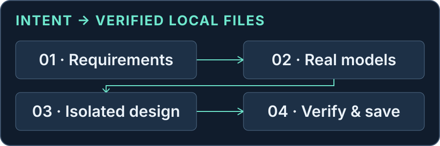

# Codex JLC EDA

[简体中文](README.md) · **English**

Let an AI assistant design small, low-voltage boards in isolated JLCEDA Pro copies—and verify the result against real models, connectivity and a fresh read from disk.



**Developer preview `0.11.0-alpha.3`** · **35 MCP tools** · **macOS / EDA Pro 4.1.60** · [MIT](LICENSE)

[Quick start](#quick-start) · [Capabilities](#capabilities) · [Validation status](#validation-status) · [Use and recovery](#use-and-recovery) · [Contributing](#contributing)

> This is an Alpha developer preview. The previously identified ZIP64 decompression issue has been fixed with `fflate 0.8.3`, and the SDK updated to `1.31.0`; see the [security assessment](docs/dependency-security.md). The RC example has not been executed, and Alpha.3 has not been installed or tested in the real editor. This is not an official JLCEDA or OpenAI project.

## Capabilities

Provide requirements and a project path. The assistant looks up actual parts, checks internal identities and pin geometry, plans placement, and verifies each stage.

| Task | Current scope |
|---|---|
| Inspect and verify | Project identity, real library models, schematic pins, PCB pads, nets and copper objects |
| Create a low-voltage board | Native blank template → schematic → PCB synchronization and native review → placement, rules and bounded connections |
| Modify a completed project | Derive from a genuine closed result; add ordinary two-terminal R/C parts, replace real compatible parts, or reconnect a local branch with creation provenance |
| Adjust a PCB locally | Bounded hole/track, reference-label and project-local stencil changes, with preservation checks |
| Save and deliver | Save both documents, read a fresh disk copy and compare the full design; generate local Gerber, BOM, CPL, previews and checks |

The target is a small, two-layer board with one schematic page and one board. Passive ECO is limited to ordinary top-side, two-terminal resistors/non-polar MLCCs, orthogonal rotations and compatible geometry, with 1–2 parts per stage. Connector ECO, arbitrary footprint replacement, high-speed/RF/high-voltage work, multiple boards and arbitrary whole-board optimization are outside this preview's commitments.

## Quick start

### 1 · Prepare the environment

- macOS and **JLCEDA Pro desktop 4.1.60**. The browser edition is not supported. The official CLI is part of the desktop client; other client versions have not been qualified here. [Official CLI documentation](https://prodocs.lceda.cn/cn/api/guide/cli.html)
- A Codex desktop host that can run local stdio MCP servers, and **Node.js ≥20**. The launcher prefers `CODEX_MCP_NODE_PATH`, then `node` on PATH.
- Native UI interaction requires desktop capabilities provided by the host; this package does not grant screen or mouse permissions. Without them, the operator handles the exact window steps for creating a template, opening a model, replacing a part or confirming import.

### 2 · Use the precompiled runtime package

The user-facing asset is `codex-jlc-eda-0.11.0-alpha.3-runtime.zip`. [Pre-release page](https://github.com/aning0922/codex-jlc-eda/releases/tag/v0.11.0-alpha.3) · [Runtime ZIP](https://github.com/aning0922/codex-jlc-eda/releases/download/v0.11.0-alpha.3/codex-jlc-eda-0.11.0-alpha.3-runtime.zip) · [Checksums](https://github.com/aning0922/codex-jlc-eda/releases/download/v0.11.0-alpha.3/SHA256SUMS). After downloading the assets:

1. Put the runtime ZIP and `SHA256SUMS` in the same directory and calculate the digest:

   ```sh
   shasum -a 256 codex-jlc-eda-0.11.0-alpha.3-runtime.zip
   ```

   The output must match its entry in `SHA256SUMS`. Checksums detect changed bytes; they do not replace trust in the publisher.
2. Extract to a stable directory, keeping both the root `.agents/` and `plugins/jlc-eda/`. Bundles are included: **no npm install is needed**.
3. Register the local source and install it. The installation subcommand was confirmed in the local Codex CLI:

   ```sh
   codex plugin marketplace add "/absolute/path/to/unpacked-runtime"
   codex plugin add jlc-eda@jlc-eda-alpha --json
   codex plugin list --marketplace jlc-eda-alpha --json
   ```

4. If an older source is installed, disable its same-named plugin while retaining its cache, so two `jlc_eda` servers are not confused. When a reload is needed, wait for a suitable break in other work, fully restart the desktop host, then verify the version in a fresh context. A version directory is not proof that the host loaded it. [Official local plugin guidance](https://developers.openai.com/plugins/build/plugins#install-a-local-plugin-manually)

This is installation from a local runtime package. The source Git repository does not include `dist`; adding a Git marketplace is not a verified zero-build installation path. **Alpha.3 has not actually been installed.** The existing installed-file check was performed on Alpha.1.

### 3 · Make the first request

> Use the JLCEDA assistant to check the environment. Report the actually loaded plugin version, tool count and editor connection status. Only inspect the environment for now.

The target is `pluginVersion=0.11.0-alpha.3` and `publicToolCount=35`. If `editorConnected=false`, open the EDA desktop editor first. For a nonstandard installation, set `JLCEDA_CLI_PATH` to the absolute path of the official executable.

You can also run `node dist/cli.mjs doctor` inside the runtime package's `plugins/jlc-eda/`. This checks a separate CLI process; it does not prove the chat host loaded that version.

<details>
<summary><strong>Developers: build from source</strong></summary>

Enter the source root containing this project's `package.json`. Always bind npm to that root explicitly, rather than allowing it to search a parent project.

```sh
PROJECT_ROOT="$(pwd -P)"
node -e 'const p=require("./package.json"); if(p.name!=="codex-jlc-eda" || p.version!=="0.11.0-alpha.3") process.exit(1)'
npm --prefix "$PROJECT_ROOT" ci --ignore-scripts --no-audit --no-fund
npm --prefix "$PROJECT_ROOT" test
npm --prefix "$PROJECT_ROOT" run test:protocol
npm --prefix "$PROJECT_ROOT" run package
```

Outputs are under `release/0.11.0-alpha.3/`: source/runtime ZIPs, per-file manifests and checksums. Protocol tests use a simulated CLI and do not open EDA. See [testing details](docs/testing.md) (Chinese).

</details>

## Use and recovery

Describe the task without inventing UUIDs, session IDs or individual track coordinates:

- “Inspect an isolated copy of this project and check every pin, pad net and copper connection.”
- “Build a low-voltage RC filter board from a fresh blank template, select real parts, and verify the saved result by reading it from disk.”
- “Derive a copy of my completed board and replace C1 with a real 100 nF part using compatible geometry. Preserve everything else and check the BOM and saved design.”

The [eight-component RC example](examples/rc-filter/README.md) is a **specification awaiting execution**: 8 components, 13 pins, 3 nets and one real C1 replacement from 10 nF to 100 nF. It is not a completed tutorial or evidence of physical performance. The detailed specification and operational references are currently in Chinese; public MCP tool descriptions also remain in Chinese.

| Status | Next action |
|---|---|
| `needs_ui` | Complete the native step in the exact work window identified by the tool, then verify with the same request. Keep the PCB in front during import review; do not repeat import. |
| `unknown` / `pending` | Preserve receipts, project and journal; perform read-only diagnosis. Do not change requestId, edit the journal or blindly replay a write. |
| `failed` / `unsupported` | Address the specific model, provenance or geometry gap. A compatible alternative may be selected before writes; parameters are frozen after writing. |
| `ok` / `closed` | Success applies to the current stage. Persistence requires an independent disk read; closed reuse only verifies a historical completed result. |

Detailed rules: [everyday use](skills/jlc-eda-project/references/usage.md) · [passive modifications](skills/jlc-eda-project/references/passives.md) (Chinese).

## Validation status

| Subject | Available evidence | Not established |
|---|---|---|
| Inherited 0.10.0 capabilities | Existing real-editor records for bounded board and passive workflows | General qualification for arbitrary circuits, footprints or rotations |
| Alpha.1 | Independent builds, 103 offline tests, all 35 tool schemas and compiled MCP checks; 19 installed files matched | Alpha loaded in the chat host or the RC workflow completed; the last observed service was still 0.10.0 |
| Alpha.3 developer preview | Dependency fixes, 105 offline tests, normal archive content comparisons and compiled protocol checks; see [validation record](docs/validation.md) | Actual host loading, a complete real-editor RC run or physical performance; see [Actions](https://github.com/aning0922/codex-jlc-eda/actions) for remote status |

Logical correspondence, full copper connectivity, strict DRC, visual inspection and disk persistence are separate checks. Manufacturing file generation is not production approval. Assembly orientation, machine zero orientation, mechanical/3D fit and physical performance still require confirmation. Uploads, orders and payments need separate explicit authorization.

## Data and licensing

The local MCP processes projects, copies and manufacturing files. Library lookup, accounts and synchronization may use JLCEDA's official services. Tool results are sent to the AI host and may include paths, reference labels, nets, model information and previews; handling depends on the host's settings. **Local MCP does not mean data never leaves the machine.** The plugin does not require an additional model API key.

Project-owned code, prose and the original conceptual graphic use [MIT](LICENSE). The 31 bundled dependencies retain [their own licenses](THIRD_PARTY_NOTICES.txt). Real library models, native projects, screenshots and manufacturing data do not automatically inherit MIT; historical materials are excluded from the package. See [source and distribution boundaries](docs/sources-and-licenses.md) (Chinese).

## Contributing

[Contribution guide](CONTRIBUTING.md) · [Security reporting](SECURITY.md) · [Roadmap](docs/roadmap.md) · [Changelog](CHANGELOG.md) · [Pre-release notes](docs/releases/0.11.0-alpha.3.en.md)

Use the [Issue templates](https://github.com/aning0922/codex-jlc-eda/issues) for ordinary feedback and provide only the version, platform, status code and a redacted minimal reproduction. Do not publish complete projects or journals. Please report vulnerabilities through the [private reporting channel](https://github.com/aning0922/codex-jlc-eda/security/advisories/new), not an ordinary Issue. No email address or response deadline is promised.

---

[简体中文](README.md) · **English**
