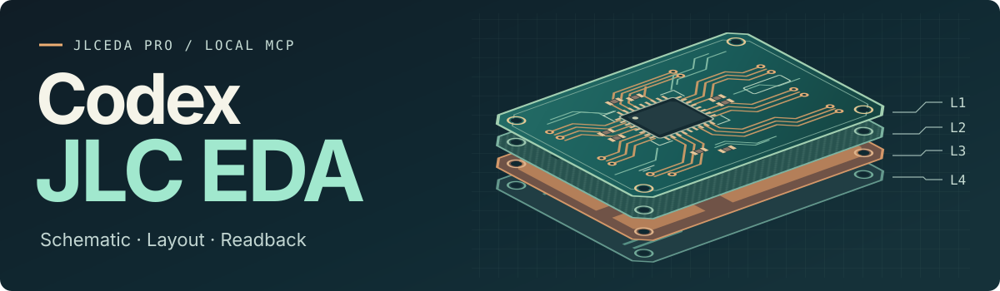

<div align="center">

# Codex JLC EDA

### From a design brief to a verifiable schematic and PCB

A local MCP / Skill plugin for JLCEDA Pro.<br>
Real component models · Isolated work copies · Native placement and routing · Verified saves

[简体中文](README.md) · **English**

[Latest results](#latest-results) · [Quick start](#quick-start) · [RC example](examples/rc-filter/README.md) · [Validation](docs/validation.md) · [Changelog](CHANGELOG.md)

</div>



| Development source | Published runtime | Public interface | License |
|:---:|:---:|:---:|:---:|
| `0.11.0-dev.a31-r4` | [Alpha.3](https://github.com/aning0922/codex-jlc-eda/releases/tag/v0.11.0-alpha.3) | **35 MCP tools** | [MIT](LICENSE) |

As of 2026-11-20, the development build can extend a low-voltage board that already has copper. In a working copy, it can add a schematic sheet, connect pins left open on an earlier sheet, place new parts on either side and route connections in batches. It reopens the saved project from disk to check the netlist, existing copper and remaining connections.

## Latest results

### Four-layer STM32H563 controller · partial routing

EDA Pro 4.1.105 saved and reopened a board with **12 schematic sheets, 265 components and 161 nets**. This routing stage closed 74 gaps on 37 target signal nets. An independent reconstruction from four Gerber copper layers and the NC drill files matched the editor’s connectivity groups on all 161 nets.

The board went from **487 to 348 remaining connections**. Strict DRC separately reported **480 unconnected markers**, with zero shorts or clearance violations. A fresh Codex host loaded A31-r4 and reopened the saved board read-only. [Validation record](docs/validation.md)

### Two-layer RC filter · complete routing and component replacement

On EDA Pro 4.1.71, a blank project became an eight-component, 13-pin board. All three nets connected through 21 trace segments and no vias, with zero strict DRC errors. After C1 changed from **10 nF to 100 nF**, reopening confirmed that the original copper was intact. All 41 manufacturing files passed their checks. Assembly orientation, 3D fit and physical performance still need verification. [RC example](examples/rc-filter/README.md) · [Development status](docs/development-status.md)

## Capabilities

Describe the circuit and project location. The assistant uses tools to read, plan, execute and verify each stage.

| Stage | Current capability |
|---|---|
| **Understand a project** | Project identity, real library models, complete native records, schematic pins, PCB pads and copper connectivity |
| **Draw and synchronize** | Draw from a blank template and synchronize the PCB, or extend a routed working copy one sheet at a time and connect pins left open on earlier sheets |
| **Place and modify parts** | Define the outline, mounting holes and placement on a two- or four-layer board. When adding a sheet, place new SMD parts or parts with round plated through-holes on the bottom side. Add, replace or reconnect ordinary two-pin passives |
| **Route and pour copper** | Use bounded native routing or submit up to 32 specified connections per batch. Vary trace width by segment on the outer layers, use through-vias and create solid pours on inner or outer layers. Verify via annular contact and thermal spokes after refill |
| **Preserve the design** | Compare complete before/after archives, preserve non-target content, avoid replaying unknown writes, and diagnose or recover using the original request |
| **Save and deliver** | Save both documents, verify in a fresh disk context, generate local Gerber / BOM / CPL files, previews and hash manifests |

Combined verification accepts up to **12 sheets, 500 components and 256 named nets** per board. The separate passive-edit workflow accepts 1–2 ordinary two-pin resistors or non-polar MLCCs per stage and requires compatible orientation and footprint geometry. High-speed, RF, high-voltage and multi-board designs, as well as unrestricted whole-board autorouting, still need separate qualification. [Multi-sheet design and local routing](skills/jlc-eda-project/references/usage.md)

## Quick start

### 1 · Choose a version

| Your goal | Entry point | What to expect |
|---|---|---|
| Use or develop the multi-sheet, four-layer workflows | Current source, `0.11.0-dev.a31-r4` | Build and install the runtime ZIP using the steps below |
| Use the existing precompiled package | [Alpha.3 pre-release](https://github.com/aning0922/codex-jlc-eda/releases/tag/v0.11.0-alpha.3) | Installable community preview from 2026-10-10, predating the A6–A31 work |

Requirements: **macOS, Node.js ≥20, JLCEDA desktop Pro, and a Codex host supporting local stdio MCP**. Version 4.1.60 is the earlier baseline; 4.1.71 and 4.1.105 have the bounded qualifications above. Other platforms, versions and `.eprj3` paths need separate checks. Native interaction requires host desktop capabilities or operator assistance. [Official CLI documentation](https://prodocs.lceda.cn/cn/api/guide/cli.html)

### 2 · Build the latest source

```sh
git clone https://github.com/aning0922/codex-jlc-eda.git
cd codex-jlc-eda
PROJECT_ROOT="$(pwd -P)"
node -e 'const p=require("./package.json"); if(p.name!=="codex-jlc-eda" || p.version!=="0.11.0-dev.a31-r4") process.exit(1)'
npm --prefix "$PROJECT_ROOT" ci --ignore-scripts --no-audit --no-fund
npm --prefix "$PROJECT_ROOT" test
npm --prefix "$PROJECT_ROOT" run test:protocol
npm --prefix "$PROJECT_ROOT" run package
```

The build writes source and runtime ZIPs, file manifests and `SHA256SUMS` to `release/0.11.0-dev.a31-r4/`. Unpack the runtime ZIP and install it in step 3.

<details>
<summary><strong>Use the published Alpha.3 runtime</strong></summary>

Download the [runtime ZIP](https://github.com/aning0922/codex-jlc-eda/releases/download/v0.11.0-alpha.3/codex-jlc-eda-0.11.0-alpha.3-runtime.zip) and [SHA256SUMS](https://github.com/aning0922/codex-jlc-eda/releases/download/v0.11.0-alpha.3/SHA256SUMS). Compare this digest with its manifest entry before unpacking into a permanent directory.

```sh
shasum -a 256 codex-jlc-eda-0.11.0-alpha.3-runtime.zip
```

Keep the root `.agents/` and `plugins/jlc-eda/` directories. The runtime includes its bundles and needs no `npm install`. The published version uses `fflate 0.8.3` and MCP SDK `1.31.0`; see the historical [dependency security review](docs/dependency-security.md).

</details>

### 3 · Install the unpacked local runtime

These commands accept the root of either runtime ZIP described above. Confirm the chosen version first.

```sh
codex plugin marketplace add "/absolute/path/to/unpacked-runtime"
codex plugin add jlc-eda@jlc-eda-alpha --json
codex plugin list --marketplace jlc-eda-alpha --json
```

If an older source provides the same plugin, disable that source and keep its cache to avoid confusing two `jlc_eda` services. When reloading is necessary, fully restart the desktop host at a convenient break, then check the loaded version in a fresh context. [Local plugin installation](https://developers.openai.com/plugins/build/plugins#install-a-local-plugin-manually)

Installed-file matching and actual host loading are separate checks. The source repository excludes `dist`; a Git source is not a verified zero-build installation path. The launcher prefers `CODEX_MCP_NODE_PATH`, then `node` on PATH. Set `JLCEDA_CLI_PATH` for a nonstandard editor installation.

### 4 · Start a conversation

> Use the JLCEDA assistant to check the environment. Report the loaded plugin version, tool count and editor connection status. Only check the environment for now.

Expect your installed version and **35** tools. If `editorConnected=false`, open the desktop editor first. With the development build, try one of these requests.

> Build a low-voltage RC filter board from a fresh blank template. Verify real parts and every pin, complete the schematic and PCB, check connectivity, and verify saving through fresh disk readback.

> Derive a copy of the saved four-layer board. Connect a deferred MCU pin from the previous sheet to a new sheet. Preserve the existing traces, then reopen the saved board and report the netlist changes and remaining connections.

## Validation and recovery

A clean install of A31-r4 passed **250/250 offline tests**. The compiled MCP matched the protocol definitions for all 35 tools and rejected all 35 invalid inputs. [Validation record](docs/validation.md)

On 2026-11-20, the full `npm audit` reported **3 high and 5 moderate findings** in the locked dependencies. The runtime bundles include the MCP SDK, Zod and fast-uri. [Dependency security review](docs/dependency-security.md)

| Returned status | Next step |
|---|---|
| `needs_ui` | Complete the specified native step in the exact window, then verify with the same request |
| `unknown` / `pending` | Preserve the project, receipts and journal; diagnose read-only before further action |
| `failed` / `unsupported` | Address the specific model, source, geometry or state issue |
| `ok` / `closed` | Read the scope of that stage's evidence; final persistence requires independent disk readback |

[Daily use](skills/jlc-eda-project/references/usage.md) · [Passive changes](skills/jlc-eda-project/references/passives.md) · [Testing](docs/testing.md) · [Roadmap](docs/roadmap.md)

## Data and licensing

The local MCP handles projects, copies and manufacturing files. Library search, accounts and synchronization may use JLCEDA services. Tool outputs go to the AI host and can include paths, models and previews, subject to that host's settings. This plugin requires no additional LLM API key.

Original code, documentation and the concept diagram use [MIT](LICENSE); bundled dependencies retain [their own licenses](THIRD_PARTY_NOTICES.txt). Real library models, native projects, editor screenshots and manufacturing materials stay local. Public regression tests use synthetic data. [Sources and redistribution boundaries](docs/sources-and-licenses.md)

## Contribute

[Contribution guide](CONTRIBUTING.md) · [Report an issue](https://github.com/aning0922/codex-jlc-eda/issues) · [Security policy](SECURITY.md) · [Releases](https://github.com/aning0922/codex-jlc-eda/releases)

Include versions, platform, status codes and a sanitized minimal reproduction. Report security issues through the [private reporting channel](https://github.com/aning0922/codex-jlc-eda/security/advisories/new).
