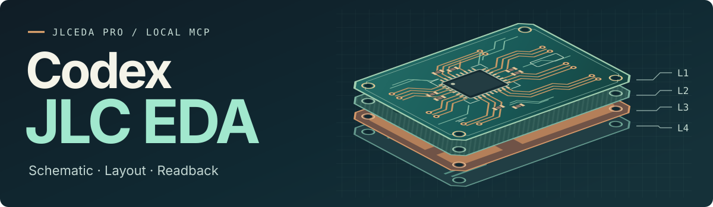
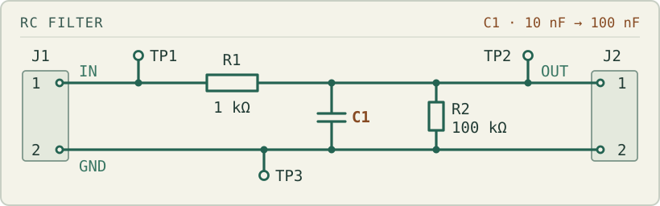

**简体中文** · [English](README.en.md)　｜　[安装](#快速开始) · [案例](#工程实测) · [工作流](#工作流程) · [文档](#文档与支持)

# 在 Codex 中使用嘉立创 EDA 专业版

告诉 Codex 工程位置和改动目标，例如“把滤波电容换成 100 nF，保留原有走线”。插件通过 **35 个本地 MCP 工具**读取真实器件，在副本上修改原理图与 PCB，保存后从磁盘重开，核对引脚、焊盘和铜连接。

**开发源码** `0.11.0-dev.a31-r4` · **预编译运行包** [Alpha.3](https://github.com/aning0922/codex-jlc-eda/releases/tag/v0.11.0-alpha.3) · **许可** [MIT](LICENSE)

## 工程实测

### 四层控制板 · 接着已有走线完成一批信号网

从已有走线的 STM32H563 控制板派生副本后，**37 个目标信号网**共消除 74 处断点。在 EDA Pro 4.1.105 中保存并重开工程，核对了 **12 页原理图、265 个器件、161 个命名网络和 887 项逻辑引脚分配**。

| 检查项目 | 实机结果 |
|---|---|
| 全板铜连接 | 计入本阶段的供电和回流走线后，待连数从 **487 降到 348**。原有铜连通组均保留。 |
| 制造数据复核 | 从四层 Gerber 铜层与镀通钻孔重建焊盘连通组，**161/161 个网**与编辑器回读一致。 |
| 严格设计规则检查（DRC） | **480 个未连标记**，短路 0 项，间距违规 0 项。整板仍需继续布线。 |

新启动的 Codex 宿主加载了 A31-r4，以只读方式重开最终工程并关闭检查副本。[验收记录](docs/validation.md)

### RC 滤波板 · 换一颗电容并验证原有走线



在 EDA Pro 4.1.71 中，从空白双层板完成绘图、首次 PCB 同步、布局和布线。随后由已保存的成品派生副本，将 C1 换为封装兼容的 **100 nF** 实际料号，并核对 BOM。

| 规模 | 铜连接与规则 | 交付检查 |
|---|---|---|
| 8 个器件、13 个引脚、3 个网 | 3 个网全部布通，21 段走线、0 过孔，严格 DRC 为 0 | 换料后原有走线通过磁盘回读，41 个制造文件通过检查 |

图中连接来自公开需求表。这个案例完成了文件级验收，装配方向、3D 配合和样板性能仍待验证。[复现步骤与连接表](examples/rc-filter/README.md) · [开发进展](docs/development-status.md)

## 快速开始

需要 **macOS、Node.js 20 或更高版本、嘉立创 EDA 桌面专业版**，以及支持本地插件的 Codex。下方的多页、四层板和 RC 换料案例使用开发构建。若要复现这些流程，请选择源码版。

<details>
<summary><strong>从源码构建 A31-r4</strong> · 多页设计、四层板和局部布线</summary>

在新目录克隆仓库。`npm run check` 会构建插件、运行离线及协议检查，并生成运行包。

```sh
git clone https://github.com/aning0922/codex-jlc-eda.git
cd codex-jlc-eda
PROJECT_ROOT="$(pwd -P)"
node -e 'const p=require("./package.json"); if(p.name!=="codex-jlc-eda" || p.version!=="0.11.0-dev.a31-r4") process.exit(1)' &&
  npm --prefix "$PROJECT_ROOT" ci --ignore-scripts --no-audit --no-fund &&
  npm --prefix "$PROJECT_ROOT" run check
```

成功后校验两个 ZIP，并进入解包后的 runtime 目录。

```sh
cd "$PROJECT_ROOT/release/0.11.0-dev.a31-r4" &&
  shasum -a 256 -c SHA256SUMS &&
  unzip -q codex-jlc-eda-0.11.0-dev.a31-r4-runtime.zip -d runtime &&
  cd runtime
```

</details>

<details>
<summary><strong>下载 Alpha.3 运行包</strong> · 免构建的早期社区预览</summary>

Alpha.3 发布于 2026-10-10，早于 A6–A31 的开发工作。将两个文件下载到同一个空目录，在该目录中校验并解包。[runtime ZIP](https://github.com/aning0922/codex-jlc-eda/releases/download/v0.11.0-alpha.3/codex-jlc-eda-0.11.0-alpha.3-runtime.zip) · [SHA256SUMS](https://github.com/aning0922/codex-jlc-eda/releases/download/v0.11.0-alpha.3/SHA256SUMS)

```sh
runtime_zip=codex-jlc-eda-0.11.0-alpha.3-runtime.zip
awk -v name="$runtime_zip" '$2 == name' SHA256SUMS | shasum -a 256 -c - &&
  unzip -q "$runtime_zip" -d runtime &&
  cd runtime
```

此包自带依赖，包括 `fflate 0.8.3` 与 MCP SDK `1.31.0`。[依赖审计](docs/dependency-security.md)

</details>

**安装到 Codex。** 在上面选定的 runtime 解包根目录执行以下命令。该目录包含 `.agents/` 和 `plugins/`，安装后请保留。

```sh
codex plugin marketplace add "$PWD"
codex plugin add jlc-eda@jlc-eda-alpha --json
codex plugin list --marketplace jlc-eda-alpha --json
```

打开嘉立创 EDA，在新 Codex 聊天中做第一次只读检查。

> 使用嘉立创 EDA 助手检查环境，告诉我当前加载的插件版本、可用工具数，以及是否已连接编辑器。

预期结果是所选版本、**35** 项工具和 `editorConnected=true`。若仍报告旧版，检查是否启用了两个同名来源，再重新加载宿主。若 EDA 安装在非默认位置，将 `JLCEDA_CLI_PATH` 指向官方 CLI 可执行文件。Node 路径可通过 `CODEX_MCP_NODE_PATH` 指定。[本地插件安装说明](https://developers.openai.com/plugins/build/plugins#install-a-local-plugin-manually)

## 工作流程

在 MCP 客户端，`jlc_eda_read_connectivity` 用于核对引脚与网络，`jlc_eda_check_pcb` 分别报告铜连接和严格 DRC，`jlc_eda_finish_work_project` 负责保存与独立回读。[完整工具定义](https://github.com/aning0922/codex-jlc-eda/blob/main/tests/fixtures/public-tools.json)

| 工程任务 | 插件执行的操作 | 如何核对结果 |
|---|---|---|
| 读懂已有工程 | 在只读副本中取得真实符号、封装、引脚、焊盘及网络 | 对照原理图和 PCB，检查同一个引脚最终落在哪个焊盘和网络上 |
| 新建或扩展原理图 | 从空模板绘图，或向有走线的单板新增图页并接入旧页预留引脚 | 对比所有图页的网表、原有焊盘分配和新增器件 |
| 调整布局与走线 | 设置双层或四层板框和安装孔，放置器件，分批布线、换层和重铺实心铜面 | 读取逐段线宽、过孔、孔环接触和热焊盘辐条，再运行严格 DRC |
| 保存与交付 | 将原理图与 PCB 写入工作副本，重开后生成本地 Gerber、BOM、CPL | 比较磁盘中的完整设计，检查制造文件并生成摘要清单 |

多页合并校验每板最多 **12 页、500 个器件、256 个命名网络**。指定局部布线每批最多 **32 条连接**。增页时，新增贴片件及采用圆形镀通孔的器件可放到底面。独立阻容修改每阶段支持 1–2 个方向和几何兼容的常规两脚电阻或无极性 MLCC。[多页与布线用法](skills/jlc-eda-project/references/usage.md) · [阻容修改](skills/jlc-eda-project/references/passives.md)

<details>
<summary><strong>原生窗口、后台副本与中断恢复</strong></summary>

工作副本默认在后台打开。需要原生选料器或导入复核时，新建副本可指定 `renderMode: "visible"`。

- `needs_ui` 指明需要操作的窗口。完成原生步骤后，用同一请求核验。
- `pending` 或 `unknown` 表示写入结果待确认。保留副本、回执和 journal，先只读诊断。
- `ok` 对应当步操作，`closed` 表示工作副本已完成保存、独立回读及关闭。整板是否布通要看铜连接和严格 DRC 结果。

</details>

## 验证与兼容性

- **软件回归**　A31-r4 在干净安装下通过 **250/250 项离线测试**。编译后的 MCP 匹配 35 项工具定义，并拒绝全部 35 个非法输入。[测试说明](docs/testing.md) · [GitHub Actions](https://github.com/aning0922/codex-jlc-eda/actions/workflows/ci.yml)
- **桌面环境**　4.1.60 是早期基线。4.1.71 有完整 RC 流程记录，4.1.105 有多页四层板和跨宿主回读记录。其他平台、编辑器版本及 `.eprj3` 工程需单独验证。高速、射频、高压、多板设计和任意整板自动布线也超出当前实测范围。[版本与验收范围](docs/development-status.md)
- **依赖状态**　2026-11-20 的 `npm audit` 对锁文件报告 3 项高危、5 项中危。进入运行包的相关依赖及审计结果见[依赖安全核查](docs/dependency-security.md)。

## 文档与支持

[日常操作手册](skills/jlc-eda-project/references/usage.md) · [RC 示例](examples/rc-filter/README.md) · [变更记录](CHANGELOG.md) · [路线图](docs/roadmap.md) · [贡献指南](CONTRIBUTING.md)

工程副本和制造文件在本地处理。库搜索、账户与同步可能使用嘉立创服务，返回给 AI 宿主的内容可能含工程路径、模型和预览。插件无需单独的大模型 API Key。项目代码、文档与原创插图采用 MIT 许可，打包依赖保留各自许可，真实库模型和原生工程由使用者在本地读取。[来源与分发](docs/sources-and-licenses.md) · [第三方许可](THIRD_PARTY_NOTICES.txt)

提交反馈时请附上插件与 EDA 版本、平台、返回状态及脱敏复现步骤。安全问题请使用私密报告渠道。[GitHub Issues](https://github.com/aning0922/codex-jlc-eda/issues) · [安全报告](SECURITY.md)
